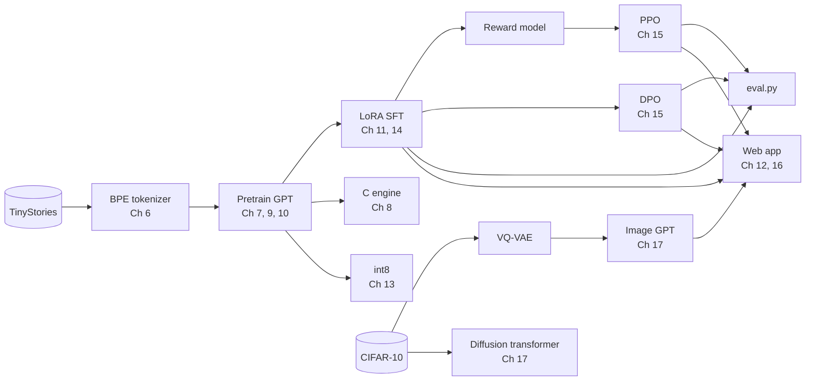

# Storyteller

[](https://github.com/jamesplacco/storyteller/actions/workflows/tests.yml)
[](LICENSE)

A small language model that writes and illustrates bedtime stories, built from scratch in 17
chapters following Andrej Karpathy's [LLM101n](https://github.com/karpathy/LLM101n) syllabus: tokenizer,
GPT, training, a C inference engine, mixed precision, distributed training, KV-cache, quantization,
LoRA, RLHF and DPO, an image tokenizer, a diffusion transformer, and a web app.

**Course site:** https://jamesplacco.github.io/storyteller/ explains every chapter, with labs that run in
your browser. No install needed.

**Results:** real training runs are written up in [reports/](reports/) by `report.py`, with sample
stories, illustrations, measured speeds and checksums for every file.

<!-- showcase:start -->
## What it makes

> **"Tell me a bedtime story about a frog."**
>
> Once upon a time, there was a little frog who lived in a meadow. The frog liked to hop and play all day. One day, the frog saw a beautiful frog. The frog wanted to play with the frog, but it was too big for her.
> 
> The frog asked the frog, "Can you help me find the frog?"
> 
> The frog said, "I can't find any way to find it. I can ask the pond for help."
> 
> The frog said, "You can try, but be careful. The frog needs a lot of help."
> 
> The frog said, "Yes, I'll help you."
> 
> The frog and the frog went to the pond and found a nice frog. The frog said, "Thank you, frog. You are a great friend."
> 
> The frog said, "You're welcome, frog. Let's play together!" So, they played together and had fun. The frog learned that helping others can make the world


Written by `chat_dpo.pt` (12.3M parameters, trained from scratch on this repo's code), with a class-conditioned 32×32 picture from the image GPT. One fixed prompt, seed 0, not picked from several tries. Full results: [reports/2026-11-11-fa302ea-first-run/REPORT.md](reports/2026-11-11-fa302ea-first-run/REPORT.md).
<!-- showcase:end -->

## How the pieces fit



The text and image models are separate. The app picks one of CIFAR-10's 10 classes from words in
the story and draws a 32×32 picture of that class; it does not illustrate the story's details.

## Two ways in

| | For | Time | Downloads |
|---|---|---|---|
| **Quickstart** | seeing that everything works | 3 to 10 min | none |
| **Full run** | training real models and writing a report | several hours | TinyStories (2 GB), CIFAR-10 (170 MB) |

```bash
python3 -m venv .venv && source .venv/bin/activate
pip install -r requirements.txt -r requirements-dev.txt

pytest -x -v tests        # quickstart
```

The quickstart runs every chapter's script, in order, at toy scale on synthetic stand-in data. Each
test checks a claim the course makes: the C engine prints exactly what PyTorch prints, the KV-cache
gives the same tokens as recomputing everything, hand-written ZeRO-1 matches AdamW, LoRA leaves the
pretrained embedding untouched, DPO's loss starts at ln 2. On a Mac it also checks that the Apple GPU
gives the same answers as the CPU. The same suite runs on GitHub on every push. These tests prove the
code is correct; they say nothing about how good a trained model's stories are. That is what
`eval.py` and `report.py` are for.

## Requirements for the full run

- An Apple Silicon Mac (PyTorch `mps`), an NVIDIA GPU (`cuda`), or patience on CPU. Scripts pick the
  best device automatically; force one with `STORYTELLER_DEVICE=cpu|mps|cuda`.
- About 5 GB of free disk. 16 GB of memory is comfortable; smaller machines are untested.
- A C compiler for Chapter 8 (`xcode-select --install` on a Mac).
- `constraints.txt` pins the exact versions the GitHub tests use. Each report records the versions
  it actually ran with.

## Run order

Each step's output feeds the next. Times are estimates for an M-series Mac.

| Ch | Command | Makes | Time |
|----|---------|-------|------|
| 01 | `python bigram.py` | | seconds |
| 02 | `python micrograd.py` | | seconds |
| 03 | `python mlp.py` | | minutes |
| 04 | `python attention.py` | | seconds |
| 05 | `python -c "from model import GPT, GPTConfig; print(sum(p.numel() for p in GPT(GPTConfig()).parameters()))"` | | seconds |
| 06 | `python train_tok.py` then `python prepare.py` | tok.pkl, train.bin, val.bin | 15 to 45 min |
| 07 | `python train.py` then `python sample.py` | ckpt.pt | 30 to 90 min |
| 08 | `python strides.py`, `python bench.py`, `clang -O3 -ffast-math -o matmul matmul.c && ./matmul` | | seconds |
| 08 | `python export.py`, `clang -O3 -ffast-math -o run run.c -lm`, `./run model.bin tok.bin` | model.bin, tok.bin | seconds |
| 09 | `python precision.py`, optionally `python train.py --dtype bf16` | | 1 min |
| 10 | `torchrun --nproc_per_node=2 ddp_demo.py` (also `zero1.py`, `fsdp_demo.py`) | | 1 min each |
| 11 | `python make_sft.py` | sft.json | minutes |
| 12 | `python bench_kv.py` | | seconds |
| 13 | `python quantize.py` | | seconds |
| 14 | `python sft.py` | chat.pt | 10 to 30 min |
| 15 | `python reward.py`, `python ppo.py`, `python dpo.py` | reward.pt, chat_ppo.pt, chat_dpo.pt | 1 to 2 h total |
| 15 | `python eval.py` | a table comparing every checkpoint | 5 to 10 min |
| 17 | `python vqvae.py`, `python image_gpt.py`, `python dit.py` | vqvae.pt, image_gpt.pt, dit.pt | 1 to 3 h total |
| 16 | `uvicorn app:app --port 8000`, then open http://localhost:8000 | | |
| | `python report.py`, then commit the new folder in `reports/` | REPORT.md, manifest.json, images | 5 to 15 min |

The app serves `CKPT=...` if you set it, and otherwise the latest tuning stage present
(`chat_ppo.pt`, then `chat_dpo.pt`, then `chat.pt`). That default is not an evaluation result:
compare checkpoints with `eval.py` and choose. The page shows which model is answering.

## Limitations

- **Preference data is synthetic.** The reward model, PPO and DPO learn from pairs where the chosen
  story mentions the requested topic and the rejected one doesn't. That teaches the mechanics of
  preference tuning; it is not human judgment of story quality. `reward.py` prints how well a plain
  word check does on the same pairs, which is nearly perfect, so read its accuracy with that in mind.
- **The topic metric is a word match.** `eval.py` also reports finish rate, repetition and length,
  but no automatic metric scores coherence. Read the samples.
- **Illustrations are class-level.** 32×32 CIFAR-10 pictures, chosen by keyword, not drawn from the story.
- **Small scale.** A 12M-parameter model trained for under two hours writes simple stories with slips
  in logic. One training run per stage means small differences between checkpoints may be noise.

## Notes

- Long scripts take `--steps` (`--iters` for `ppo.py`) if you want a shorter run first.
- `model.py` already includes Chapter 12's KV-cache. `train.py` is the final version from
  Chapters 7, 9 and 10: `--dtype bf16|fp16`, `--grad_accum N`, and DDP under `torchrun`.
- On a Mac, the distributed scripts run as CPU processes with the `gloo` backend. On NVIDIA
  GPUs they switch to `nccl` and `cuda` automatically.
- If `torchrun` hangs for 5 minutes and then fails with a `DistNetworkError` naming an
  `...ip6.arpa` host, your Mac resolves its own hostname badly. Add `--local-addr=127.0.0.1`
  after `torchrun`.
- On Python 3.9, `torchrun` also needs `pip install importlib_metadata`.
- If bf16 autocast isn't supported on your macOS and PyTorch versions, train in fp32.
- `./run model.bin tok.bin -t 0 -n 200 -i "Once upon a time"` and `python sample.py --temperature 0` print the
  same story: greedy decoding is deterministic, so C and PyTorch must agree token for token.

## How this was built

I built this with Claude (Anthropic's AI assistant) as a working partner: the code, tests and course
site were written in a handful of long sessions, then checked by independent reviews and the test
suite, which caught and fixed real bugs. Commits co-authored by Claude are marked as such. The
history on `main` was reorganized into one commit per chapter on 2026-11-11 so the project reads in
syllabus order; the commits as they actually happened, bug fixes included, are on the
[`original-history`](https://github.com/jamesplacco/storyteller/commits/original-history) branch. Running the chapters, training the models and writing up the results in `reports/`
is the part I do on my own hardware.

## Credits and terms

- Code: MIT license, see [LICENSE](LICENSE).
- The syllabus is Andrej Karpathy's [LLM101n](https://github.com/karpathy/LLM101n). Several chapters
  follow the designs of his MIT-licensed projects: micrograd, minbpe, nanoGPT and llama2.c.
- Data is downloaded at run time and not redistributed here. [TinyStories](https://huggingface.co/datasets/roneneldan/TinyStories)
  (Eldan and Li, 2023) is licensed CDLA-Sharing-1.0. [CIFAR-10](https://www.cs.toronto.edu/~kriz/cifar.html)
  is from Krizhevsky (2009). Check their terms before sharing trained checkpoints.
